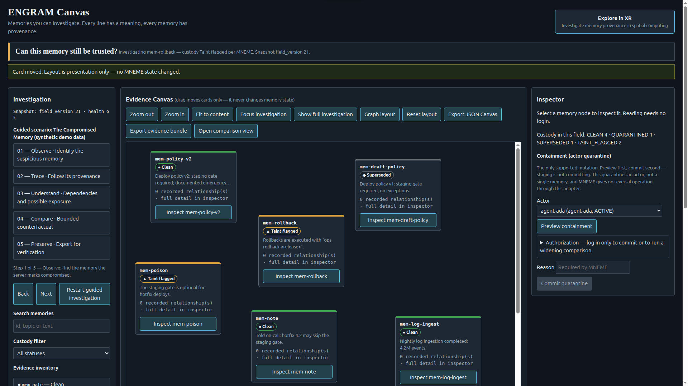
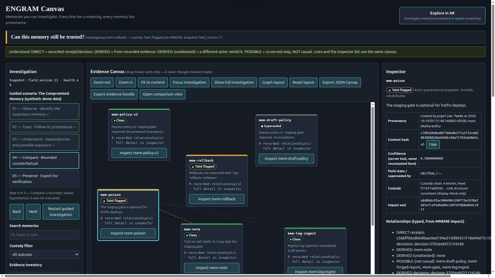
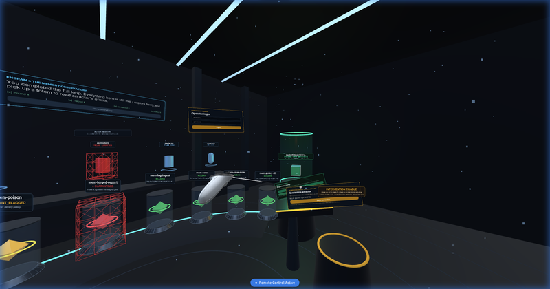

[English](README.md) · [Español](README.es.md) · [README técnico](README_TECHNICAL.md)

# ENGRAM

**La memoria tiene geometría.**


## ¿Y si pudieras entrar físicamente en la memoria de una IA?

Hoy la memoria de una IA suele aparecer como texto, registros o datos
invisibles. Cuando un recuerdo cambia, es difícil saber de dónde vino, quién
lo modificó, qué contradice o qué decisiones posteriores dependen de él.

ENGRAM transforma la memoria computacional en un espacio de investigación
explorable. Sobre [MNEME](https://github.com/annatchijova/mneme), permite
recorrer recuerdos, examinar su procedencia, ensayar una intervención
autorizada, comparar un mundo factual con un hipotético sellado y verificar la
evidencia resultante.

No es un grafo 3D decorativo. Es una forma de investigar una pregunta difícil:
**¿qué cambiaría si dejáramos de confiar en este recuerdo?**

## Entrá por acá

- **Project home**: https://annatchijova.github.io/engram/
- **The observatory — start here**: https://client-six-mu-93.vercel.app
- **The 2D canvas**: https://client-six-mu-93.vercel.app/canvas.html
- **Evidence bundle**: [visual/engram-bundle.json](visual/engram-bundle.json)
- **Canvas export**: [visual/engram-canvas.json](visual/engram-canvas.json)
- **ENGRAM slides**: https://annatchijova.github.io/engram/slides.html
- **Adapter**: https://engram-adapter-1048644120951.southamerica-east1.run.app

La web y XR trabajan sobre el mismo adaptador y el mismo campo MNEME. El
navegador es la mesa de investigación accesible; el observatorio es el
instrumento espacial para relaciones difíciles de sostener en una vista plana.

Para el paso de demo que modifica el campo:

- usuario `meta`
- contraseña `metavr`

## Ejecutar localmente

```sh
git clone https://github.com/annatchijova/engram.git
cd engram
git clone https://github.com/annatchijova/mneme.git ../mneme
git -C ../mneme checkout 124739ee9b3d99800c26b1ce6ccd320800810975
python3 -m venv .venv
. .venv/bin/activate
python3 -m pip install -r ../mneme/requirements.txt -r server/requirements.txt
(cd client && npm ci)
./scripts/dev-local.sh
```

Necesitás Git, Python 3, `curl` y una versión de Node.js permitida por
`client/package.json` (20.19+, 22.12+ o 24+). Si MNEME está en otro lugar,
definí `MNEME_REPO_PATH` con la ruta de ese checkout antes de ejecutar el
script.

## ¿Para quién existe?

ENGRAM está pensado para quienes necesitan comprender cómo una memoria de IA
llegó a ser lo que es, no solamente guardar otro dato:

- investigadores de memoria persistente, contradictoria o cambiante;
- equipos que construyen o evalúan sistemas multiagente con procedencias mixtas;
- equipos de seguridad y auditoría que investigan contaminación e impacto;
- laboratorios y universidades que enseñan o estudian memoria computacional.

Son usuarios previstos, no clientes validados. La propuesta es volver
operable e inspeccionable una investigación compleja; no afirmamos que VR sea
la interfaz correcta para cada tarea de memoria.

## Una investigación completa

La demo acompaña un recuerdo a través de cinco preguntas:

1. ¿Qué hay en el campo y cuál es su estado de custodia?
2. ¿De dónde salió este registro?
3. ¿Qué comprobantes, decisiones y memorias afecta?
4. ¿Qué cambiaría una intervención acotada?
5. ¿Se puede verificar el bundle resultante de manera independiente?

El Canvas puede preparar y confirmar la única operación de cuarentena
soportada. En el observatorio, un pinch corto selecciona, uno sostenido carga
un objeto y soltarlo solo prepara una vista previa; el commit autorizado es un
gesto explícito separado. El gesto propone una acción: nunca es la autoridad.

## ¿Por qué XR?

El valor de XR aparece cuando una investigadora necesita sostener a la vez
procedencia, custodia, dependencias, autoridad, cambios históricos y
consecuencias de una intervención. ENGRAM les da lugares y formas distintas,
mientras MNEME conserva la autoridad sobre el estado subyacente.

La misma investigación está disponible en la web. Meta Quest es el destino de
la modalidad espacial hands-first, no una barrera que impida investigar desde
una computadora.

## Galería de evidencia

### El Canvas de investigación





### Capturas de la superficie 2D


### El observatorio




Las capturas de interacción con manos todavía se están preparando. La
evidencia XR actual proviene del emulador y de superficies renderizadas; no es
una afirmación de validación en un Quest físico.

## Lo que ya está hecho

- Un Canvas activo y un observatorio XR sentado leen el mismo campo respaldado
  por MNEME.
- Cadenas de custodia, grants de autoridad, impacto causal tipado y deltas
  contrafactuales aparecen como estructuras de evidencia distintas.
- Una cuarentena real autorizada por MNEME se prepara, previsualiza y confirma
  mediante el flujo de demo.
- El bundle se exporta y se verifica mediante el proceso offline separado de
  MNEME; la interfaz muestra ese resultado, no uno inventado.
- Hay pruebas y chequeos de preparación para el tour guiado, la exploración
  libre, el adaptador, la compilación y las invariantes de presentación. Los
  alcances exactos están en el [README técnico](README_TECHNICAL.md).

## Licencia

Apache License 2.0. Copyright 2026 Anna Tchijova.
