# ENGRAM

**Geometry of Evidence**  
*Memory Has Geometry.*

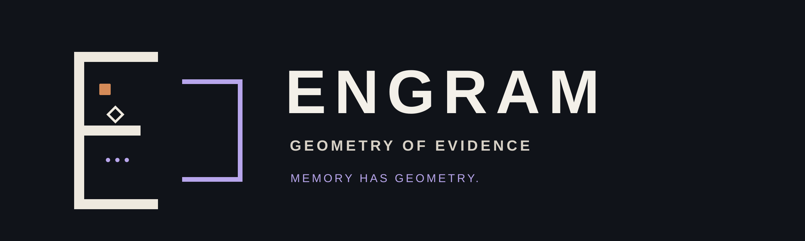

ENGRAM is an immersive XR environment for inspecting and operating on computational memory as spatial, verifiable structures.

It is being designed on top of [MNEME](https://github.com/annatchijova/mneme): MNEME decides and proves; ENGRAM makes those decisions inspectable and operable through the body.

## Live

- **Project home**: https://annatchijova.github.io/engram/
- **The observatory — start here**: https://client-six-mu-93.vercel.app
- **The 2D canvas**: https://client-six-mu-93.vercel.app/canvas.html
- **Evidence bundle**: [visual/engram-bundle.json](visual/engram-bundle.json)
- **Canvas export**: [visual/engram-canvas.json](visual/engram-canvas.json)
- **ENGRAM slides**: https://annatchijova.github.io/engram/slides.html
- **Adapter**: https://engram-adapter-1048644120951.southamerica-east1.run.app

Open the observatory link and let it load the field. On a Quest, open it in
the headset browser and accept the immersive session the page offers; on a
laptop the same scene runs flat, where you look around by dragging and act
by clicking. The first card
asks one question and offers **Begin investigation**, which walks the whole
case in five steps. **Explore freely** opens every surface at once instead.

Nothing needs an account until the single step that changes the field. For
that one, log in on the containment console:

- username `meta`
- password `metavr`

That account acts as Analyst Omar, the one actor MNEME has granted
`QUARANTINE_ACTOR`. Reading the field, opening a record and its custody
chain, tracing impact, running the exclusion forecast, and exporting and
verifying a sealed bundle all work with no login. The client carries a
read-only token that the adapter refuses for every write, so the public link
can inspect the field and cannot alter it.

What you are looking at is a real MNEME field, not a mock: each memory was
produced through MNEME's own authorized API, the custody chains are
hash-linked, the causal classes come from `causality.impact()`, and the
bundle is checked by an independent stdlib-only verifier running as a
separate process.

**Known limitations, stated plainly:**

- The adapter runs as a single instance and keeps its field in the container,
  so a cold start reseeds the demo field. A quarantine you commit is real and
  immediately visible, but it does not survive the service going idle.
- With every surface revealed at once, ten panels crowd the seated view. The
  guided tour paces them; free exploration is still dense.
- The experience has been validated in the IWER Quest 3 emulator, not on
  physical hardware. Comfort and legibility in a headset are unproven.

## Two surfaces, one field

**The canvas is the operational surface.** An investigator queries memories,
examines provenance, reconstructs dependencies, compares bounded hypotheses,
prepares an intervention — and commits the one intervention the engine
authorizes. Memories enter the system through MNEME's own authorized API, not
through ENGRAM: this room inspects and contains, and never invents evidence.
That is a design constraint, not a gap. The adapter exposes exactly one
mutation, and the public read token is refused for it.

**The observatory is the spatial surface.** You enter the same live field and
read it with your body: clusters, causal arcs and custody chains that are hard
to perceive in a flat graph. Point, pinch, pick a record up and turn it in your
hand.

They share the field, not just the design. A containment committed on the
canvas is already there when you enter the observatory, because both read the
same adapter over the same MNEME. The canvas links out to the observatory from
its header; carrying the selected memory across that link is future work.

## Visual demo

ENGRAM is an evidence investigation surface for researchers, scientists,
forensic analysts, and safety engineers. If you know Obsidian, think of ENGRAM
as a knowledge canvas where every connection has to explain its provenance.

### The investigation canvas

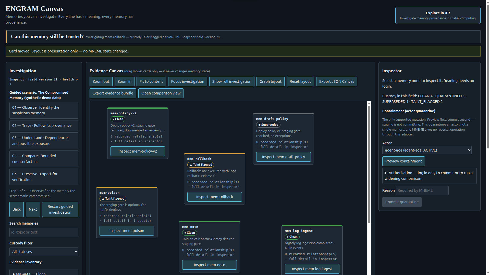

The investigator starts with a concrete question: can this memory still be trusted?

### Typed provenance

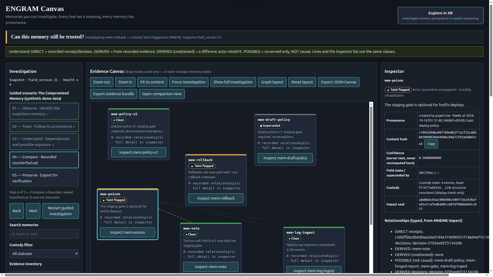

Direct, derived, unattested, and possible relationships are not collapsed into one generic graph edge.

### 2D visual references


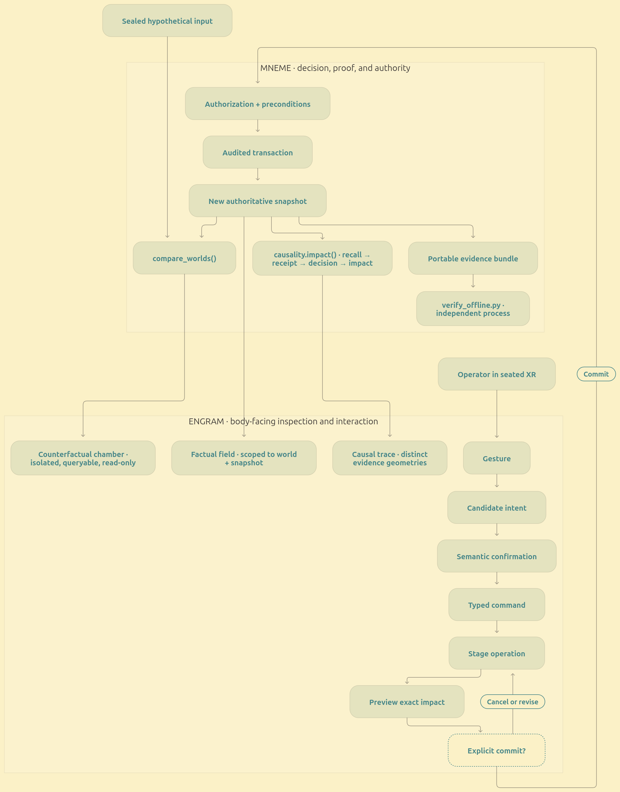


## The XR observatory

The XR client is **ENGRAM — The Memory Observatory**: a seated room where
the recorded field, its provenance, a staged intervention, a sealed
hypothetical and the verification instrument are five physically distinct
places rather than five panels.

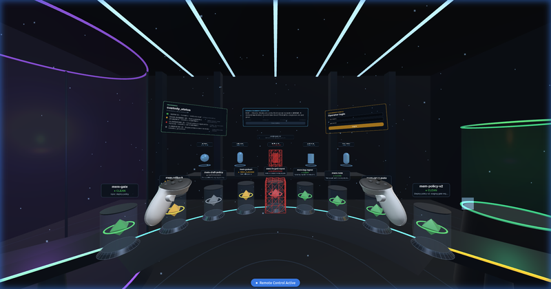

Nine memory cores on the lit bench are the real memories in MNEME. Colour
comes only from `custody_status`; every core is the same size and shape,
because size must never mean authority.

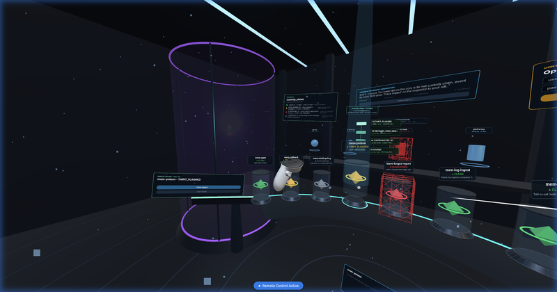

Selecting a core raises its real custody chain above it as hash-linked
blocks, in the server's own `seq` order, each labelled with the event, the
actor and the `entry_hash` prefix.

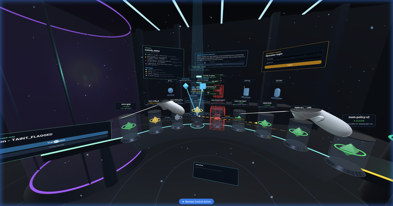

Trace draws MNEME's own `causality.impact()` result. DIRECT, DERIVED,
DERIVED (unattested) and POSSIBLE differ on colour, form, thickness and
motion at once, and every edge carries its class as text — a POSSIBLE link
can never be mistaken for a cause.

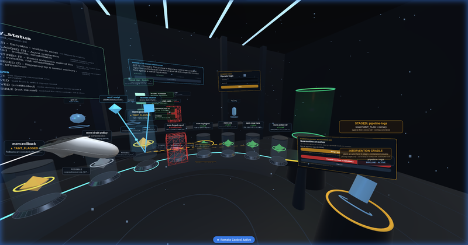

Containment is physical: place an actor totem in the intervention cradle
and the field shows an amber PREVIEW ring on exactly the memories a sweep
would flag. Nothing has changed yet. Commit is a separate, authorized
click, and MNEME refuses it outright for an actor without the grant.

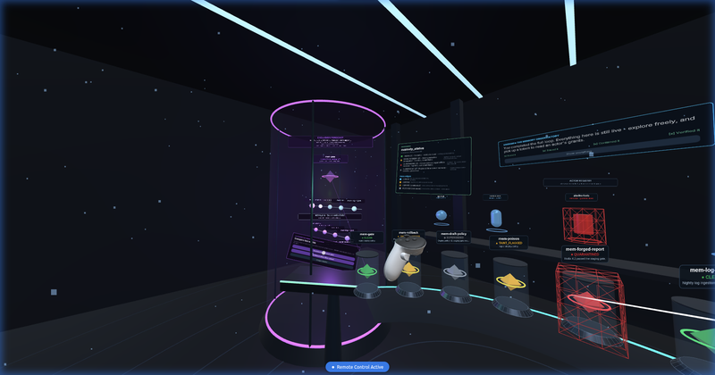

The counterfactual chamber is a separate sealed column, never a recolour
of the field: two rails show exactly what world A and world B served, with
both receipts and the delta hash.

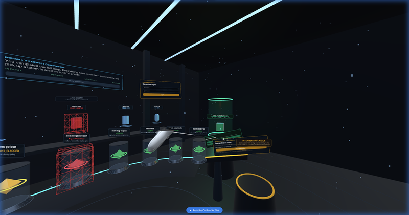

The vault holds the exported bundle, coloured by what an independent
verifier process actually printed.

### First contact

Opening the observatory shows one question over the field, *Can this
memory be trusted?*, and two choices: begin a five-step investigation or
explore freely. Each step is a question answered by one real operation,
with a marker in the room on the object that answers it, and the
technical surfaces appear as they become relevant. Nothing advances on a
timer, and the whole tour completes without writing to MNEME.

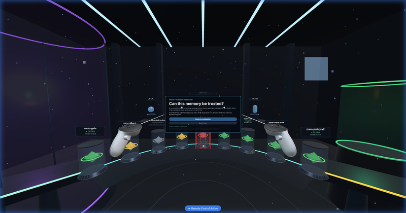

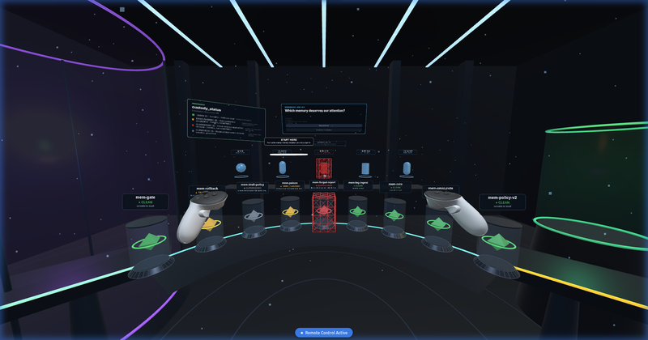

Juror login for the committing steps: user `meta`, password `metavr`.
On a flat screen, drag to look around and click to select; in a headset,
turn your head and pinch. Round 11 audited that first contact on both
surfaces and lists what only a physical Quest can settle:
[`docs/XR-AUDIT-ROUND11.md`](docs/XR-AUDIT-ROUND11.md). Round 12 is the
release-candidate assessment, with evidence separated into what tests
prove, what was observed in the emulator, what needs a headset, and what
needs real users:
[`docs/XR-RELEASE-CANDIDATE-ROUND12.md`](docs/XR-RELEASE-CANDIDATE-ROUND12.md).
Round report: [`docs/XR-GUIDED-FIRST-CONTACT-ROUND10.md`](docs/XR-GUIDED-FIRST-CONTACT-ROUND10.md).

Round 9 report with the full PASS / FAIL / NOT TESTED tables:
[`docs/XR-OBSERVATORY-ROUND9.md`](docs/XR-OBSERVATORY-ROUND9.md).
**Verified in the IWER Meta Quest 3 emulator, not on a headset.**

## Why XR

ENGRAM is not a 3D graph viewer. Its defining interaction is counterfactual analysis: a user can hold a factual world and a sealed hypothetical world apart, then inspect how memories, rankings, claims, and decisions diverge.

The spaces must remain physically and semantically distinct. A counterfactual projection is never silently treated as factual state, and ending a comparison never merges the worlds.

## Interaction boundary

Spatial state is a projection, never the epistemic authority:

```text
gesture
  → candidate intent
  → semantic confirmation
  → typed command
  → MNEME authorization and preconditions
  → audited transaction
  → new authoritative snapshot
  → XR projection
```

A physical drop never mutates state by itself. Operations such as quarantine are staged, previewed, explicitly committed, authorized by MNEME, and then reflected in XR.

Every projection is scoped to an explicit world and snapshot. Factual worlds may mutate only through authorized commands. Counterfactual worlds are isolated, queryable comparisons and cannot create factual decisions.

## Geometry is evidence-bearing

Spatial form must communicate something true about the underlying state. Direct, derived, derived-unattested, and possible evidence remain distinct.

Proximity does not automatically mean causality. Size does not mean authority. Brightness does not mean truth. Weight must not collapse confidence and standing into one signal. A line does not generically mean “related.”

## Local Canvas demo (Round 4)

```sh
./scripts/dev-local.sh   # adapter :17347 + client https://localhost:8081
python3 scripts/verify-fixture.py   # synthetic scenario, reproducible
python3 scripts/test-adapter.py     # adapter regressions on a temp field
```

Open `https://localhost:8081/` for the XR observatory, the primary
surface. `https://localhost:8081/canvas.html` is the 2D investigation
board. Guides:
`docs/DEMO-SCENARIO.md`, `docs/XR-INTERACTION-VALIDATION.md`,
`docs/SECURITY-ROUND4.md`. Spanish summary: `README.es.md`.

## Project status

The architectural destination and investigation are documented in [ENGRAM-ARCHITECTURAL-INVESTIGATION.md](ENGRAM-ARCHITECTURAL-INVESTIGATION.md).

**Nivel 1 — Provenance Field**, **Nivel 2 — Audited Containment**,
**Nivel 3 — Causal Field**, **Nivel 4 — Counterfactual Chambers**, and a
first slice of **Nivel 5 — Portable Epistemic Instrument** are all live.
Nivel 1 is read-only inspection of a real MNEME field: custody chains,
authority grants, custody status. Nivel 2 adds the first real mutation
path: an operator logs in as a real MNEME actor, stages a
`QUARANTINE_ACTOR` sweep (sees exactly which memories would be tainted
first), and only then commits — the field re-renders live with the result.
Nivel 3 adds Trace: pulling on a memory's real causal history
(`recall → receipt → decision → impact`, via MNEME's own
`causality.impact()`) and rendering DIRECT, DERIVED, and POSSIBLE as
genuinely distinct — different geometry, different line style, never
different distances of the same thing. Nivel 4 is this README's own
defining interaction, made real: MNEME's `counterfactual.compare_worlds()`
run both directions — excluding more needs no authority, revealing what
containment withheld needs the Nivel 2 session, and MNEME's own
`authority.gate` is what enforces that, not the adapter — rendered as a
translucent, spatially distinct "ghost" chamber, never a recolor of the
real field. Nivel 5's first slice adds bundle export verified by a
genuinely separate process (MNEME's `verify_offline.py`, run as a real
subprocess, never an in-process call) and a stale-snapshot precondition
on the one mutation, so a Commit staged against a field that has since
moved is rejected rather than silently applied. All of Nivel 3-5 are
fully read-only except that one mutation, which stays fully reversible up
to the moment it's committed.

- `server/` — a FastAPI adapter (`app.py`) over the sibling MNEME
  repository. Almost every endpoint is read-only; the one exception
  (`POST /api/v1/actors/{id}/quarantine`) is clearly bannered in the file
  and is the only place in all of ENGRAM that writes to MNEME, through
  MNEME's own `trust.quarantine_actor` — never a raw SQL write.
  `seed_demo_field.py` seeds a demo field the same way, using only MNEME's
  own authorized API. MNEME stays a separate service; the browser never
  touches SQLite directly.
- `client/` — a seated WebXR/IWSDK experience. Memories render as an arc of
  nodes colored by `custody_status` against a fixed, legended map; selecting
  one opens a panel with its real content, hash, and custody chain. A
  containment console lets a logged-in operator stage and commit a
  quarantine, Stage never mutating and Commit being the one explicit,
  separate gesture that does (ray/pinch in XR, mouse-click on desktop).
- **Known limitations, not hidden:** read access is a single shared bearer
  token (`ENGRAM_READ_TOKEN`); the Nivel 2 login is one demo credential
  with an in-memory, process-lifetime session — a real externally-bound XR
  actor identity is still open. Both are named in `server/app.py`'s and
  `server/README.md`'s own words, not glossed over.

The target device is a hands-first, seated WebXR/IWSDK experience for the Meta VR Start Developer Competition 2026.

## License

Apache License 2.0. Copyright 2026 Anna Tchijova.
