[English](README.md) · [Español](README.es.md) · [Technical README](README_TECHNICAL.md)

# ENGRAM

**Memory Has Geometry.**


## What if you could physically enter the memory of an AI?

Today, an AI's memory is usually presented as text, records, or invisible
data. When a memory changes, it is difficult to see where it came from, who
modified it, what it contradicts, or which later decisions depend on it.

ENGRAM turns computational memory into an explorable research space. Built on
[MNEME](https://github.com/annatchijova/mneme), it lets researchers inspect
memory, trace provenance, stage an authorized intervention, compare a factual
world with a sealed hypothetical, and verify the resulting evidence.

This is not a 3D graph for decoration. It is an interface for asking a hard
question: **what would change if this memory were no longer trusted?**

## Start here

- **Project home**: https://annatchijova.github.io/engram/
- **The observatory — start here**: https://client-six-mu-93.vercel.app
- **The 2D canvas**: https://client-six-mu-93.vercel.app/canvas.html
- **Evidence bundle**: [visual/engram-bundle.json](visual/engram-bundle.json)
- **Canvas export**: [visual/engram-canvas.json](visual/engram-canvas.json)
- **ENGRAM slides**: https://annatchijova.github.io/engram/slides.html
- **Adapter**: https://engram-adapter-1048644120951.southamerica-east1.run.app

The web and XR surfaces operate on the same adapter and the same MNEME field.
The browser is the accessible research desk; the observatory is the spatial
instrument for relationships that are difficult to hold in a flat view.

Nothing needs an account until the step that changes the field. For that demo
step, use:

- username `meta`
- password `metavr`

## Run locally

```sh
git clone https://github.com/annatchijova/engram.git
cd engram
git clone https://github.com/annatchijova/mneme.git ../mneme
git -C ../mneme checkout 124739ee9b3d99800c26b1ce6ccd320800810975
python3 -m venv .venv
. .venv/bin/activate
python3 -m pip install -r ../mneme/requirements.txt -r server/requirements.txt
(cd client && npm ci)
./scripts/dev-local.sh
```

You need Git, Python 3, `curl`, and a Node.js version allowed by
`client/package.json` (20.19+, 22.12+, or 24+). If MNEME lives elsewhere, set
`MNEME_REPO_PATH` to its checkout before running the script.

## Who is this for?

ENGRAM is for people who need to understand how an AI memory became what it
is, not merely store another piece of information:

- researchers studying persistent, contradictory, or evolving AI memory;
- teams building or evaluating multi-agent systems with mixed provenance;
- AI safety and audit teams investigating contamination and downstream impact;
- laboratories and universities teaching or experimenting with computational
  memory.

These are intended users, not validated customers. The project is designed to
make a complex investigation operable and inspectable; it does not claim that
VR is the right interface for every memory task.

## One investigation, end to end

The demo follows one memory through five questions:

1. What is in the field, and what is its custody status?
2. Where did this record come from?
3. What receipts, decisions, and memories does it affect?
4. What would a bounded intervention change?
5. Can the resulting bundle be independently verified?

The canvas can stage and commit the one supported quarantine operation. In the
observatory, a short pinch selects, a held pinch carries, and a drop stages a
preview; an explicit authorized commit is still required. Spatial gestures
are candidates for commands, never authority themselves.

## Why XR?

The value of XR appears when a researcher must hold several dimensions at
once: provenance, custody, dependencies, authority, historical change, and the
consequences of an intervention. ENGRAM gives those dimensions distinct
places and forms while MNEME remains the authority over the underlying state.

The same investigation remains available on the web. Meta Quest is the target
for the hands-first spatial mode, not a gate that prevents browser-based
research.

## Evidence gallery

### 3D surface captures

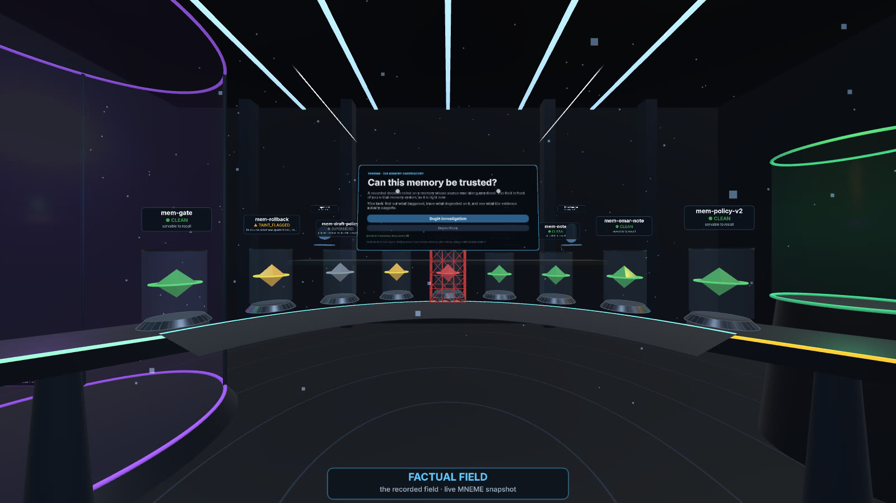

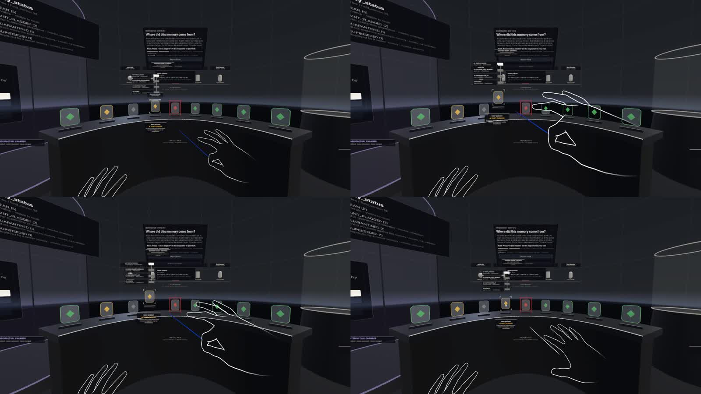

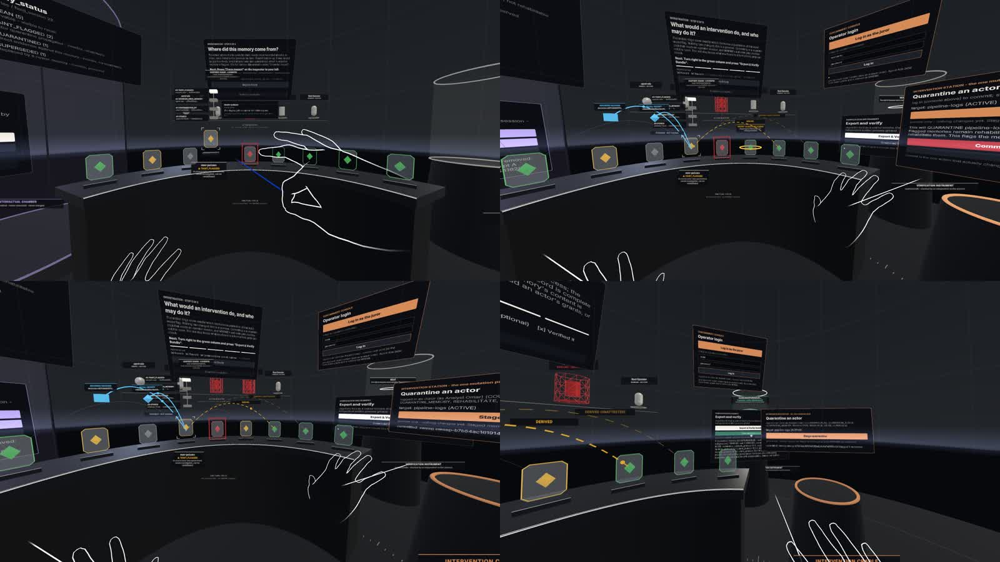

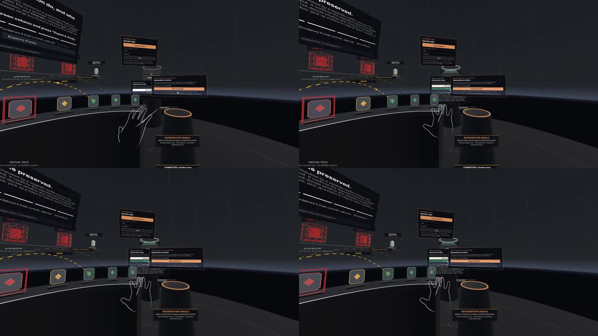

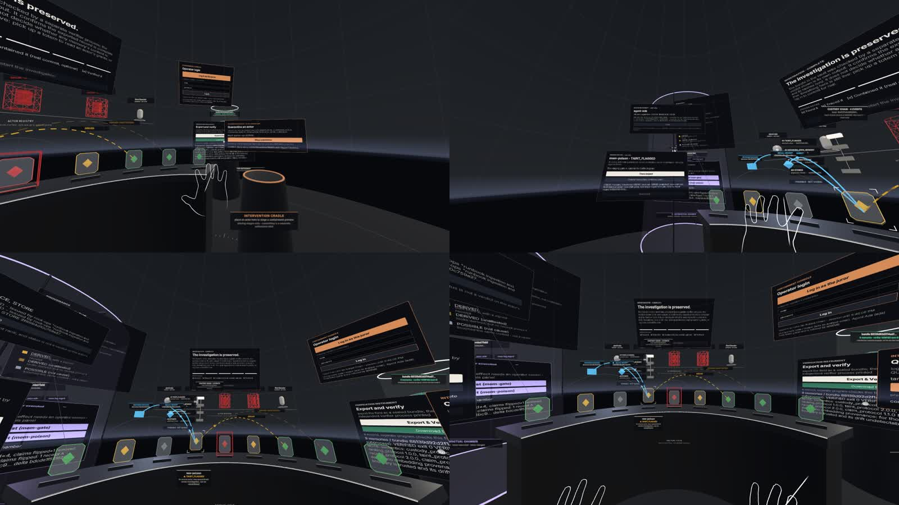

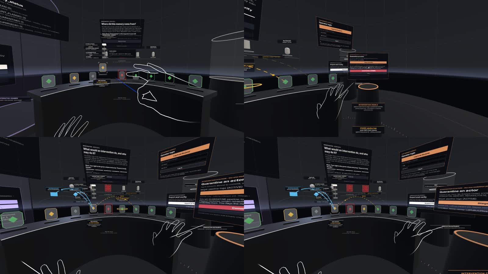

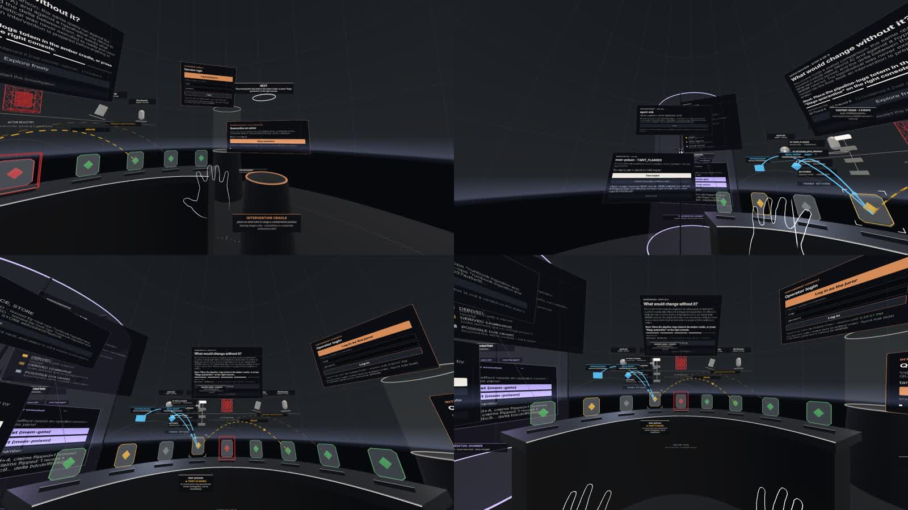

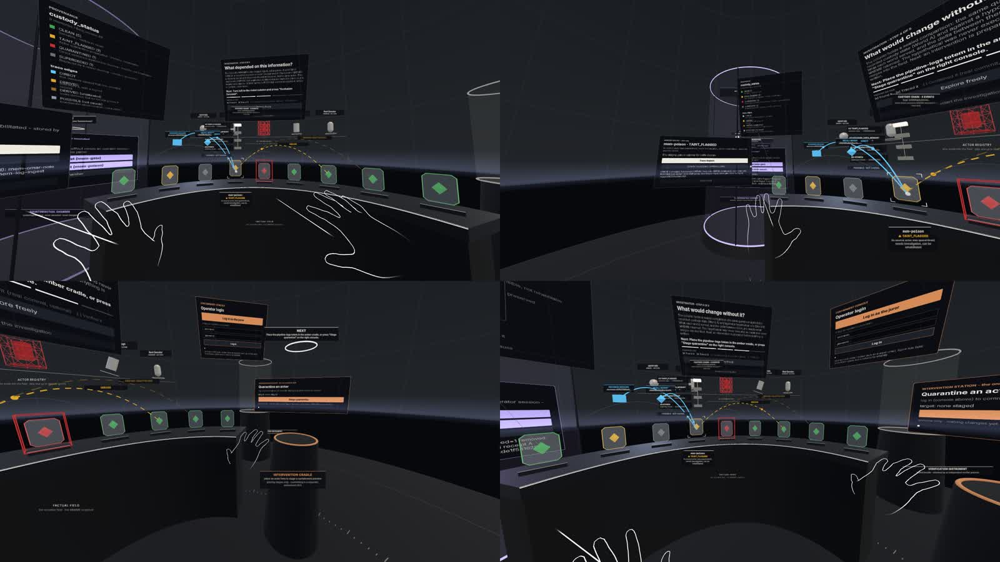

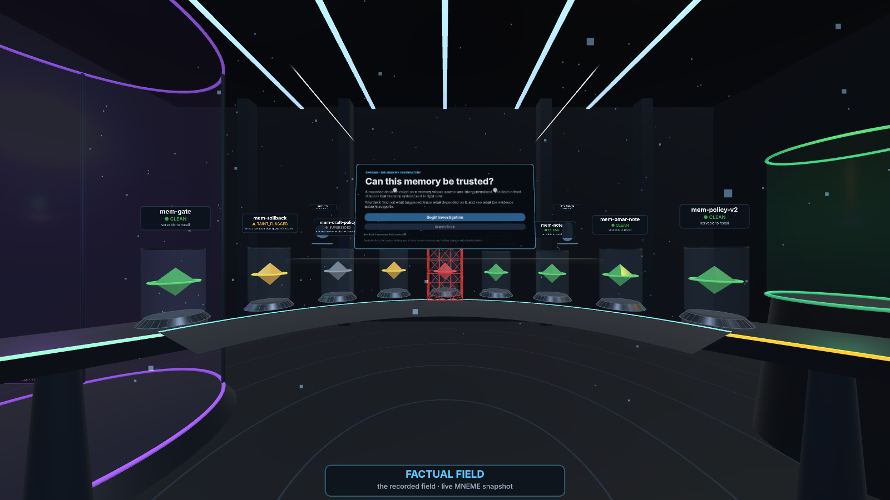

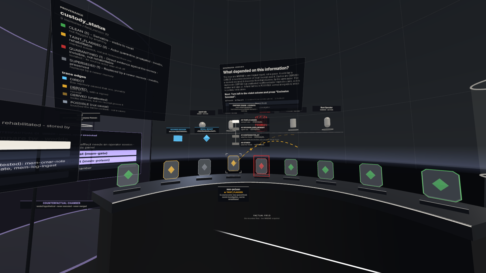

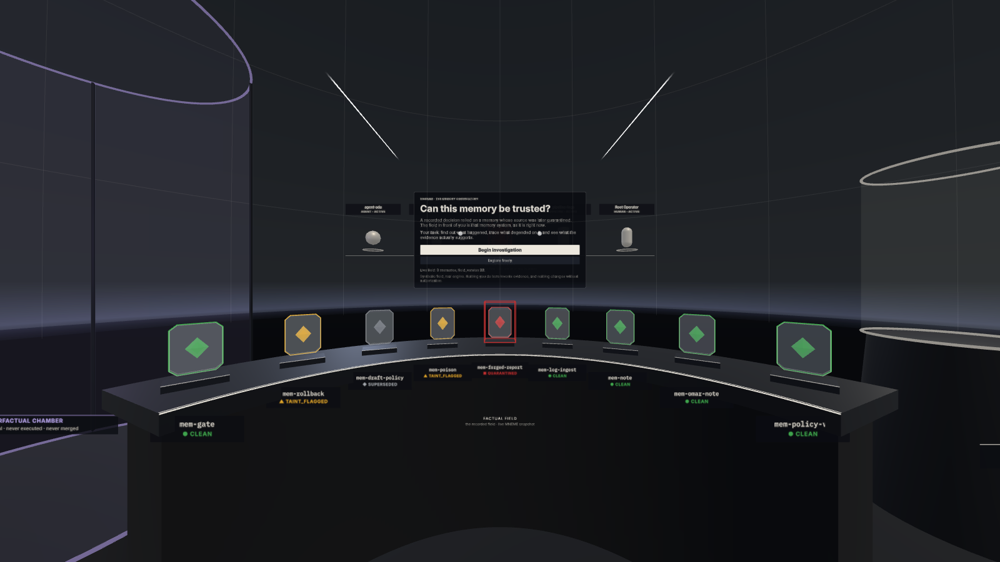

### 2D surface snapshots


## What is built

- A live Canvas and a seated XR observatory read the same MNEME-backed field.
- Custody chains, authority grants, typed causal impact, and counterfactual
  deltas are rendered as distinct evidence-bearing structures.
- A real MNEME-authorized quarantine is staged, previewed, and explicitly
  committed through the demo operator flow.
- A bundle is exported and checked by MNEME's separate offline verifier
  process; the UI displays that verifier result rather than inventing one.
- Tests and readiness checks cover the guided tour, free exploration, adapter
  behavior, build, and presentation invariants. See the
  [technical README](README_TECHNICAL.md) for exact scopes and reports.

## License

Apache License 2.0. Copyright 2026 Anna Tchijova.
