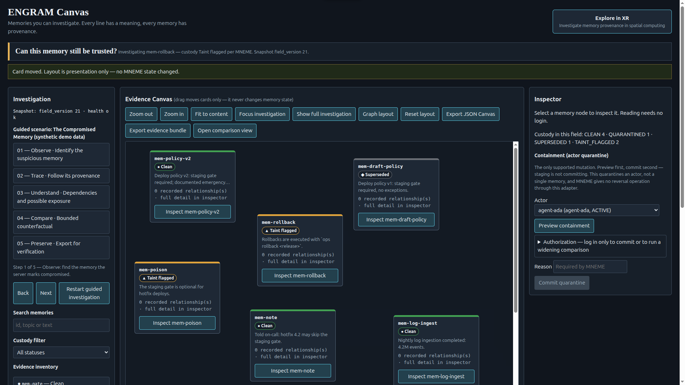
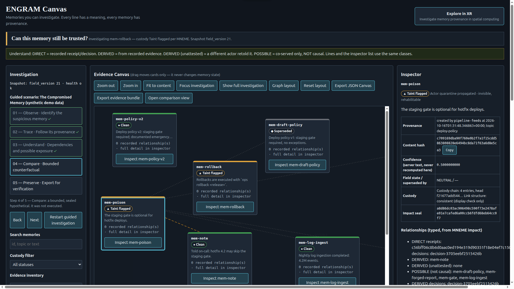
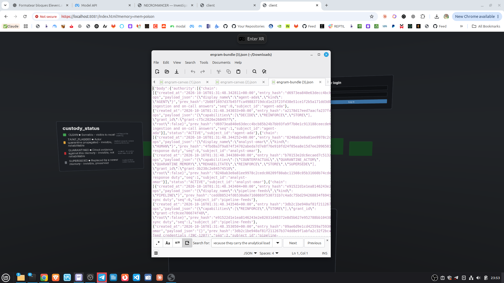

# ENGRAM Visual Demo

ENGRAM is an evidence investigation surface for researchers, scientists, forensic analysts, and safety engineers who need to understand not only what a result says, but where it came from and whether it can still be trusted.

## The mental model

If you know Obsidian, think of ENGRAM as a knowledge canvas where every connection has to explain its provenance. Obsidian organizes personal knowledge; ENGRAM investigates evidence, custody, dependencies, and bounded counterfactuals.

## Visual story

### 1. The trust question

ENGRAM starts with the moment a plausible result is no longer enough. The warm side represents the recorded factual world; the violet side represents a bounded hypothetical world.

### 2. The investigation canvas

The investigator begins with a concrete question: can this memory still be trusted? The canvas keeps the suspicious memory, surrounding context, guided investigation, and custody states visible together.

### 3. Typed provenance

ENGRAM does not treat every line as the same. Relationships are distinguished as direct, derived, unattested, or possible. The inspector exposes the memory content, hash, confidence, field state, custody chain, and impact seal.

### 4. Preserve the answer

The result is not just a visual explanation. The investigation can be exported as an evidence bundle for later verification. The demo field is synthetic; the UI and adapter path are real, and the counterfactual is explicitly sealed as never executed.

## Who would use it?

- Researchers tracing the provenance of derived findings.
- Scientists comparing a recorded result with a bounded alternative.
- Forensic analysts reconstructing custody and dependencies.
- Safety and reliability engineers investigating decisions made by automated systems.
- Teams that need to explain a result after the original context has disappeared.

## Core sentence

> ENGRAM turns a memory from something you can read into something you can investigate.

## Files

- `evidence-dual-camera.png` — factual and hypothetical worlds.
- `canvas-initial.png` — initial investigation canvas.
- `canvas-provenance.png` — selected memory with typed provenance.
- `evidence-bundle.png` — exported evidence and custody material.
- `Placa de memoria en capas-9.png` — supplementary visual plate.

